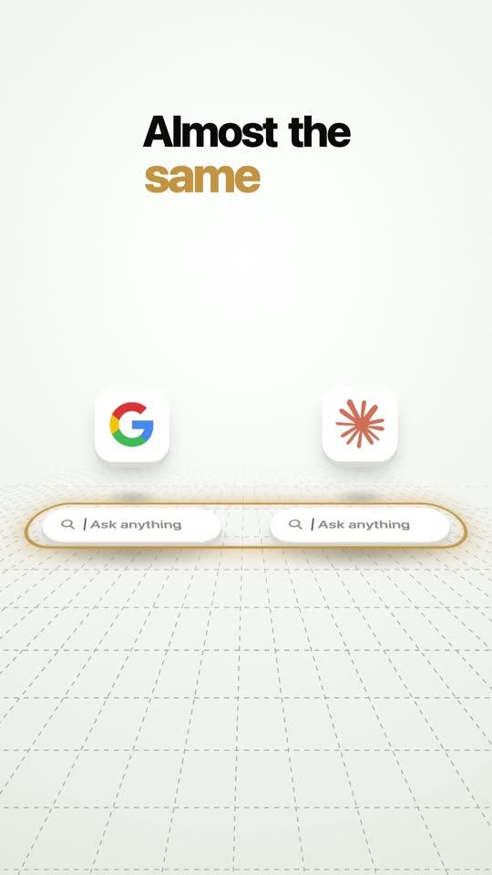

# Videos in code

Two of my videos, written in code. No After Effects, no editing app.

Every frame is a function of time: `seek(t)` draws second `t`, a small script films the page frame by frame, and ffmpeg turns the frames into an MP4.

|  |  |
|---|---|
| **Google vs Claude** (0:50). Why searching and asking are not the same. | **One day with my AI agent** (0:31). Five jobs, one chat. |

Click a picture to watch the video.

## Look inside

Open `reel.html` in Chrome. Add `?t=12` to the address to jump to second 12.

`render.sh` films the whole video (needs Node, Chrome and ffmpeg). The voice and the sound effects are not in this repo, so a render here comes out silent.

## How I made them

I describe each scene in plain words, Claude writes it as code, and I check the frames until every cut feels right.

---

© Enrico Jonathan Liman. Look and learn, but please don't re-upload the videos.
